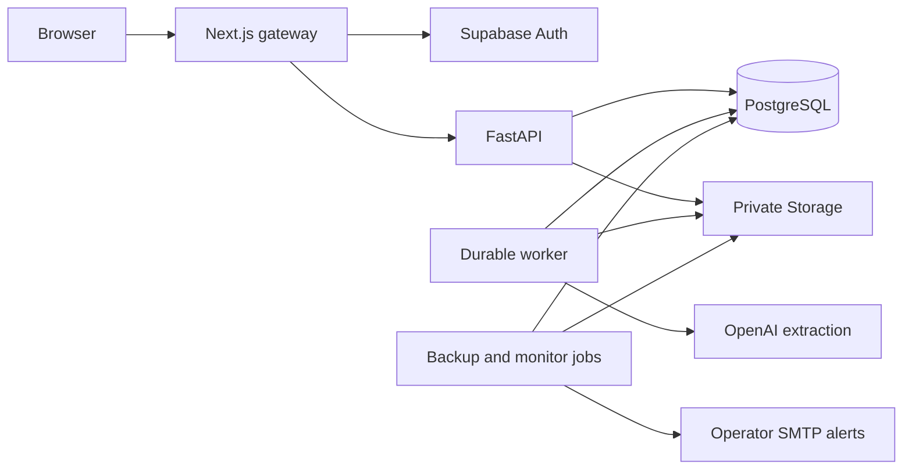

# Architecture and design decisions

Avoirly separates probabilistic document extraction from financial validation.
The model transcribes structured fields. Python owns supported-case checks,
matching, Decimal arithmetic and claim-draft templates. A valid JSON response
alone is never sufficient to create a claim.

## Components and data flow

This is a logical flow. In the deployed stack, Caddy terminates public HTTPS for
web, API and Auth/Storage. Database and application container ports are private;
the Supabase gateway binds to host loopback. The application shares one PostgreSQL
server with Supabase but uses a dedicated `avoirly` schema. Current migration:
`0003_phase5`. Deployment configuration is in [SELF_HOSTING.md](SELF_HOSTING.md).

| Component           | Responsibility                                                                      | Main source                               |
| ------------------- | ----------------------------------------------------------------------------------- | ----------------------------------------- |
| Domain contracts    | Typed extraction, validation and result models                                      | `backend/src/recovery/models.py`          |
| Extraction adapter  | Validates files, makes bounded SDK calls, records model/prompt/schema metadata      | `backend/src/recovery/extraction.py`      |
| Validation/matching | Supported scope, identity/reference checks and unique eligible line pairing         | `validation.py`, `matching.py`            |
| Comparison/drafts   | Pure Decimal calculations and deterministic FR/EN templates                         | `comparison.py`, `claims.py`              |
| API/service layer   | Identity, owner checks, named actions, revisions, quotas and idempotency            | `api/`, `service.py`, `quotas.py`         |
| Worker              | Durable acquisition, heartbeats, lease/revision guards, caching and guarded commits | `worker.py`                               |
| Tracking            | Sent snapshots, notes, promises, confirmed credits and audited voids                | `tracking.py`                             |
| Web                 | Signed sessions, server-side API gateway and French review/tracking interface       | `web/`                                    |
| Operations          | Metrics, private backup creation/restore and static operator notifications          | `operations.py`, `backup*.py`, `scripts/` |

Python filenames without a directory in the table live under
`backend/src/recovery/`. Alembic migrations live under
`backend/src/recovery/db/migrations/`.

## One case, from upload to draft

1. The authenticated API resolves the owner; the client never selects `owner_id`.
   It creates a case and attaches validated source documents under random keys.
2. Analyze persists a job with an idempotency key and the current input revision.
   A partial unique index prevents competing active jobs for that revision; an
   owner-level guard permits only one active analysis for that owner.
3. The worker claims durable work using database locks and a fresh lease token.
   Heartbeats extend the lease during processing. API memory is not the queue.
4. Each source is extracted separately. Successful results are persisted with
   source hash, model, prompt and schema metadata. Matching cached extraction can
   be reused after a partial failure; unreviewed stale-version caches cannot.
5. Python validates identities, references, numbers, totals, units, adjustments
   and line matching. Any blocker yields `NEEDS_REVIEW`, with no findings, total
   or exportable draft. A clean comparison yields `NO_DISCREPANCY`.
6. A supported discrepancy persists its calculation before generating the draft.
   Draft editing appends a version; copying/downloading sends no supplier message.

Human corrections create an audited input revision with a reason. Original
extractions remain available. Prior results stop being the current exportable
result, and validation runs again. Pair confirmation is tied to the extraction
revision and bypasses only a missing PO reference. It cannot override a conflicting
reference or another blocker.

## Concurrency and recovery

Mutations use `expected_version`; a stale edit returns 409 rather than silently
overwriting another action. Analysis idempotency keys are owner/route scoped;
reusing a key with a changed body also returns 409. Tracking requests retain
case-lifetime idempotency. Source and invoice identity reservations prevent
duplicate cases from producing a second claim.

Every worker commit checks the lease token, expiry, owner, current revision and
case state. A stopped/expired worker cannot later overwrite a correction or a
deleted case. Expired jobs require an operator to confirm the old worker is stopped
before explicit requeue. The failed attempt remains in history and a new attempt
is bounded by the revision retry cap. This is intentionally not an unlimited
automatic retry loop. See [backend recovery](BACKEND.md#interrupted-workers-and-consistency).

## Trust boundaries

- **Hosted identity:** Supabase asymmetric JWT signatures, issuer, audience,
  expiry and a pilot UUID allowlist are verified by Python. Local development
  has an explicit fixed server identity and loopback boundaries; it is a separate
  mode, not a hosted authentication fallback.
- **Files:** private buckets have no public/browser object policies. The API
  checks ownership before serving original documents or credit evidence.
- **Database:** application tables have default-deny RLS and no browser-role
  grants. Backend connections are privileged; user isolation depends on the
  reviewed Python owner checks, not automatic per-user database-role switching.
- **Secrets:** the provider key belongs only to the worker. Supabase secret keys,
  database credentials and backup keys remain server-side. The web service uses
  a publishable key, and sessions use secure HttpOnly cookies in hosted mode.
- **Model output:** typed parsing is followed by deterministic business checks.
  Every extraction warning blocks drafting. Source text supplies no tools, URLs
  to fetch or instructions to execute; one successful injection test is not a
  universal adversarial-security guarantee.

## Financial tracking and deletion

The claim amount is potential net credit. A saved external-send declaration
captures the exact draft and comparison snapshot. Promises and confirmed credits
have separate records and totals; confirmations require evidence and human
verification. Corrections preserve original entries and reasons. There is no
arbitrary financial-total setter. See [RECOVERY_TRACKING.md](RECOVERY_TRACKING.md).

Case deletion atomically revokes live access and removes case data, while a durable
outbox retains only random file keys until storage removal succeeds. Operational
quota/usage records and already retained encrypted backups have separate retention.
Deletion is not a promise to erase every external backup or cloud log immediately.

## Operations and limits

Daily application backups snapshot the application schema and source/proof
objects, encrypt with AES-256-GCM and upload to a private backup bucket. Their
scope excludes Supabase Auth and server configuration. A separate daily full
snapshot pauses writers and PostgreSQL for a clean physical copy, including Auth,
Storage, PostgreSQL custom configuration/encryption keys, runtime signing keys
and SMTP setup. It encrypts and authenticates the bundle before publication.
An automatic Windows task copies verified ciphertext outside the VM and OneDrive.

Five-minute monitoring checks worker health, leases, file cleanup, failures,
pricing and reported-cost thresholds. Both scheduled jobs share an SMTP failure
hook. Actual monitor/backup failures each delivered an operator-confirmed email.
Additional host checks detect a full snapshot older than 30 hours or a copy
acknowledgement older than 36 hours. Estimates and quotas are not billing caps.
Full recovery from Windows ciphertext passed on an unpublished internal Docker
network, including Auth logins, file hashes, ownership, draft/ledger and web
sessions. Replacement hardware, public DNS failover and production cutover remain
untested. See [DISASTER_RECOVERY.md](DISASTER_RECOVERY.md) for scope and limitations.
